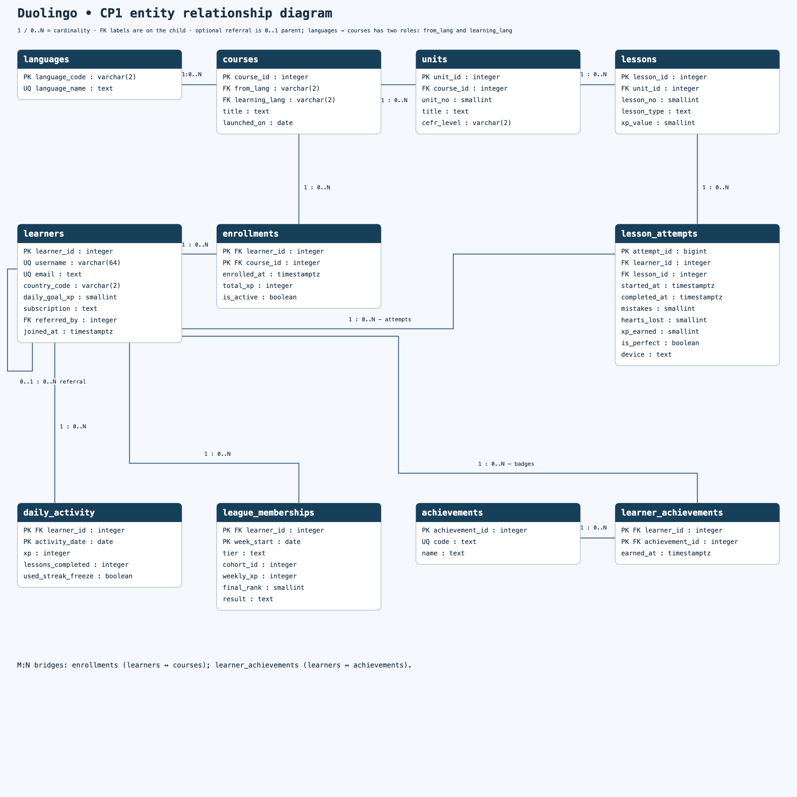

# Phase 2: Schema design and seed-data verification

## 1. Approach and reproducible setup

We inspected all rows and headers in the 11 CSV files, including distinct categories, blanks and candidate-key uniqueness. We kept the exact exported table and column names so the supplied workload remains compatible. The schema uses PostgreSQL types, keys and constraints instead of accepting everything as text. No seed rows were edited or discarded.

**Verified locally:** PostgreSQL 18.6 (Postgres.app), UTF-8, India-local reporting dates (`Asia/Kolkata`). The SQL uses features available in PostgreSQL 15+. Testing used a new, isolated database, not an existing user database. Actual output is in [02_integrity_results.txt](02_integrity_results.txt).

From the repository root, with PostgreSQL running and its tools on your PATH:

```bash
unzip -n seed_data.zip
createdb duolingo_cp1
psql -X -v ON_ERROR_STOP=1 -d duolingo_cp1 -f sql/01_schema.sql
psql -X -v ON_ERROR_STOP=1 -d duolingo_cp1 -f sql/02_load_data.sql
psql -X -v ON_ERROR_STOP=1 -d duolingo_cp1 -f sql/03_integrity_checks.sql
```

The verification database for this workspace is already loaded. Its temporary cluster is `/private/tmp/duolingo-cp1-pg`, database `duolingo_cp1`, port `55432`, listening only on its local Unix socket. Connect while it is running with:

```bash
/Applications/Postgres.app/Contents/Versions/18/bin/psql -h /private/tmp/duolingo-cp1-pg -p 55432 -d duolingo_cp1
```

This temporary runtime is not part of the submission; the scripts above recreate it in any new PostgreSQL database.

Use a **new database name** if that database already exists. The schema script deliberately does not drop existing objects. `\copy` reads local files relative to the directory where `psql` is launched. The load is one transaction, so a failed file rolls back all rows loaded in that attempt. Schema creation is also transactional. CSV blanks use PostgreSQL CSV's default NULL handling; `t`/`f` become booleans.

For later queries/benchmarks, set the connection's `search_path=duolingo` and `timezone=Asia/Kolkata` (for example, `PGOPTIONS='-c search_path=duolingo -c timezone=Asia/Kolkata'`). The scripts set these explicitly within their sessions. `timestamptz` stores instants, not the original textual timezone; the session timezone affects date casts and hour extraction. Daily summaries use the **attempt start date in India**, including a completion that crosses midnight.

## 2. Data dictionary

PK = primary key; FK = foreign key; UQ = unique. All columns are NOT NULL unless marked **nullable**. PK columns are implicitly NOT NULL. Composite keys and checks spanning multiple columns are explained below. These are deliberate business rules, not arbitrary upper bounds inferred from this one export.

### languages

| Column | Type | Constraints | Why |
|---|---|---|---|
| language_code | varchar(2) | PK; two lowercase letters | Stable short language identifier. |
| language_name | text | UQ; nonblank | Distinguishable display name; assumed unique in this catalogue. |

### courses

| Column | Type | Constraints | Why |
|---|---|---|---|
| course_id | integer | PK; positive | Stable course identifier. |
| from_lang | varchar(2) | FK → languages; RESTRICT | Speaking language must exist. |
| learning_lang | varchar(2) | FK → languages; RESTRICT | Target language must exist and differ from speaking language. |
| title | text | Nonblank | Readable label; not assumed to be a stable unique key. |
| launched_on | date | Required | Launch is a calendar date, without a time component. |

`UNIQUE(from_lang, learning_lang)` assumes one course per ordered language pair. English→Spanish and Spanish→English are different courses.

### units

| Column | Type | Constraints | Why |
|---|---|---|---|
| unit_id | integer | PK; positive | Global unit identifier used by lessons. |
| course_id | integer | FK → courses; RESTRICT | Every unit belongs to one existing course. |
| unit_no | smallint | Positive; UQ with course_id | A position is unique within its course, not globally. |
| title | text | Nonblank | Unit label may repeat across courses. |
| cefr_level | varchar(2) | A1, A2, B1, B2, C1 or C2 | Standard level domain; C2 is permitted even though absent from seed data. |

### lessons

| Column | Type | Constraints | Why |
|---|---|---|---|
| lesson_id | integer | PK; positive | Global lesson identifier used by attempts. |
| unit_id | integer | FK → units; RESTRICT | Every lesson belongs to one unit. |
| lesson_no | smallint | Positive; UQ with unit_id | A lesson's position identifies it within a unit. |
| lesson_type | text | LEARN, PRACTICE, STORY or LEGENDARY | Known activity types. |
| xp_value | smallint | Positive | Nominal reward; actual earned XP can differ because of bonuses. |

### learners

| Column | Type | Constraints | Why |
|---|---|---|---|
| learner_id | integer | PK; positive | Stable learner identifier. |
| username | varchar(64) | UQ; 3–64 ASCII letters, digits or underscores | Supports observed handles and exact sign-in lookup. |
| email | text | UQ; basic non-whitespace local@host.suffix check | Contact identifier; regex is a basic shape check, not email verification. |
| country_code | varchar(2) | Two uppercase letters | Country-code shape; does not hard-code the five observed countries. |
| daily_goal_xp | smallint | 10, 20, 30 or 50 | Supported goal presets. |
| subscription | text | FREE, SUPER or MAX; default FREE | Explicit plan segment. |
| referred_by | integer | **Nullable** FK → learners; SET NULL; cannot equal learner_id | Referral is optional; removing a referrer should not delete invitees. |
| joined_at | timestamptz | Required | Preserves the instant represented by timezone-bearing timestamps. |

Username/email uniqueness is **case-sensitive** in this schema. Case-insensitive account identity would need a separately agreed policy; we do not silently rewrite the export. The referral check prevents direct self-referrals, not longer cycles.

### enrollments

| Column | Type | Constraints | Why |
|---|---|---|---|
| learner_id | integer | Composite PK; FK → learners; CASCADE | Learner side of the learner–course relationship. |
| course_id | integer | Composite PK; FK → courses; RESTRICT | Course side; existing enrollment prevents accidental course deletion. |
| enrolled_at | timestamptz | Required | Enrollment event instant. |
| total_xp | integer | Nonnegative; default 0 | Cached course XP; larger range than per-lesson rewards. |
| is_active | boolean | Default true | Explicit active/inactive enrollment state. |

PK is `(learner_id, course_id)`: one enrollment record per learner/course pair; reactivation updates that record.

### lesson_attempts

| Column | Type | Constraints | Why |
|---|---|---|---|
| attempt_id | bigint | PK; positive | Large growing event identifier; supplied IDs remain unchanged. |
| learner_id | integer | FK → learners; CASCADE | Attempt belongs to an existing learner. |
| lesson_id | integer | FK → lessons; RESTRICT | Attempt refers to an existing lesson. |
| started_at | timestamptz | Required | Start event instant. |
| completed_at | timestamptz | **Nullable**; at or after started_at | NULL means not completed, including abandoned or still-open attempts. |
| mistakes | smallint | Nonnegative; default 0 | Error count; no artificial maximum of seven. |
| hearts_lost | smallint | 0–5; at most mistakes; default 0 | Five-heart model assumed by this workload. |
| xp_earned | smallint | Nonnegative; default 0 | Earned reward, including any bonus. |
| is_perfect | boolean | Default false; true requires completion and zero mistakes | Unfinished zero-mistake attempts are not perfect completions. |
| device | text | ANDROID, IOS or WEB | Valid client categories. |

An unfinished attempt must have zero earned XP and `is_perfect=false`. Defaults let the provided W01 start query omit progress fields. IDs have no sequence: the seed and W01 supply them explicitly; applications must allocate IDs safely. Enrollment membership is checked by an integrity query because the export has no course_id on attempts; a CHECK cannot safely enforce a cross-table join.

### daily_activity

| Column | Type | Constraints | Why |
|---|---|---|---|
| learner_id | integer | Composite PK; FK → learners; CASCADE | Summary owner. |
| activity_date | date | Composite PK | One summary per learner per calendar day. |
| xp | integer | Nonnegative; default 0 | Daily accumulated XP. |
| lessons_completed | integer | Nonnegative; default 0 | Daily completed-attempt count. |
| used_streak_freeze | boolean | Default false; true requires zero XP and completions | Freeze protects a streak on a day without completed learning activity. |

PK is `(learner_id, activity_date)`, supporting W03's `ON CONFLICT` target. Defaults let W03 omit the freeze flag. A zero-XP row alone does not prove a freeze; unfinished activity can also produce it.

### league_memberships

| Column | Type | Constraints | Why |
|---|---|---|---|
| learner_id | integer | Composite PK; FK → learners; CASCADE | Learner can have one league placement each week. |
| week_start | date | Composite PK; Monday only | Consistent weekly grouping. |
| tier | text | BRONZE, SILVER, GOLD, SAPPHIRE, RUBY, EMERALD, AMETHYST or DIAMOND | Supported league levels, stored per membership in this export. |
| cohort_id | integer | Positive | Cohort label; membership is identified by learner/week, not by cohort alone. |
| weekly_xp | integer | Nonnegative; default 0 | Cached learner XP for that league week. |
| final_rank | smallint | **Nullable**; 1–30 | Final position, absent while results are pending. |
| result | text | **Nullable**; PROMOTED, DEMOTED or STAYED | Final outcome, pending together with final_rank. |

PK is `(learner_id, week_start)`. Rank and result must either both be NULL or both be present. A cohort is addressed as `(week_start, cohort_id)` for grouping; we do not assume cohort IDs are globally unique forever. We do not enforce rank uniqueness because pending ranks are absent and a future ranking policy may allow ties. Cohort size and tier consistency need cross-row checks; tier consistency fails in this seed (see findings).

### achievements

| Column | Type | Constraints | Why |
|---|---|---|---|
| achievement_id | integer | PK; positive | Stable badge identifier. |
| code | text | UQ; uppercase letter followed by uppercase letters/digits/underscores | Stable machine-readable badge name, e.g. XP_100. |
| name | text | Nonblank | Human-readable label; not treated as an identifier. |

### learner_achievements

| Column | Type | Constraints | Why |
|---|---|---|---|
| learner_id | integer | Composite PK; FK → learners; CASCADE | Award recipient. |
| achievement_id | integer | Composite PK; FK → achievements; RESTRICT | Awarded badge type. |
| earned_at | timestamptz | Required | Award event instant. |

PK is `(learner_id, achievement_id)`: each badge can be earned once. This also supports W05's conflict target.

## 3. Constraint and deletion policy

There are **11 primary keys**, **7 additional UNIQUE constraints**, and more than the required 12 CHECK constraints. Examples include language/country/username/code formats; positive identifiers and positions; different course languages; allowed lesson/plan/level/tier/result/device/goal values; nonnegative XP and counts; valid completion order; hearts≤mistakes; perfect-completion conditions; unfinished-attempt conditions; freeze-day conditions; Monday league starts; 1–30 ranks; paired rank/result nullability; and no self-referrals. SQL is the authoritative definition.

Catalogue FKs use **RESTRICT**: deleting a language, course, unit, lesson or badge must not accidentally erase learning history. Learner-owned enrollments, attempts, activity, memberships and awards use **CASCADE** when a learner is deliberately deleted. Referral uses **SET NULL** to retain the invitee. This is a project lifecycle policy; a production system would also define retention, anonymisation and access rules. No DELETE operation was performed on the seed data.

An FK does not automatically create an index on its referencing columns. The only indexes currently present are the **18 B-tree indexes automatically created for PK/UQ constraints**: one per table PK, plus language_name, course language pair, course/unit position, unit/lesson position, username, email and achievement code. The exact inventory is in the raw results. No tuning index, materialized view or trigger has been added.

## 4. ER diagram and cardinality



The entity-relationship diagram above illustrates the 11 tables, primary keys, foreign keys, and cardinalities:
- **languages → courses (1:N):** Each course links two languages (`from_lang` and `learning_lang`).
- **courses → units (1:N):** Courses contain sequential curricular units.
- **units → lessons (1:N):** Units contain ordered lesson modules.
- **learners → enrollments (1:N) & courses → enrollments (1:N):** Resolves the M:N relationship between learners and courses.
- **learners → lesson_attempts (1:N) & lessons → lesson_attempts (1:N):** Learners attempt lessons across sessions.
- **learners → daily_activity (1:N):** Daily roll-ups of XP and activity per learner.
- **learners → league_memberships (1:N):** Weekly competitive cohort placements.
- **learners → learner_achievements (1:N) & achievements → learner_achievements (1:N):** Resolves the M:N relationship for unlocked badges.
- **learners → learners (1:N):** Self-referential relationship via `referred_by`.

Every ordinary FK child has exactly one parent; a parent can have zero or many children. A learner has zero or one referrer and can refer zero or many other learners. Enrollments resolve the **M:N** learner/course relationship; learner_achievements resolves **M:N** learner/badge. Attempts are repeatable events connecting learners and lessons. No genuine 1:1 relationship is required by these exports.

## 5. Functional dependencies and normal forms

A functional dependency (FD) `X → Y` means one X value determines exactly one Y value. We choose dependencies from business rules, not accidental patterns in a small sample. For example, repeated unit titles and the seed's lesson-type/reward pattern do not establish permanent catalogue dependencies. All attributes are atomic (1NF); non-key attributes in bridge tables depend on the full composite key (2NF).

| Table | Candidate keys and functional dependencies | Normal-form assessment |
|---|---|---|
| languages | language_code → language_name; language_name → language_code under our UQ assumption | BCNF: every determinant is a candidate key. |
| courses | course_id → all other columns; (from_lang, learning_lang) → course_id, title, launched_on | BCNF. A title is a label, not an assumed determinant. |
| units | unit_id → all other columns; (course_id, unit_no) → unit_id, title, cefr_level | BCNF. Neither course_id nor unit_no alone determines a unit. |
| lessons | lesson_id → all other columns; (unit_id, lesson_no) → lesson_id, lesson_type, xp_value | BCNF under configurable lesson rewards; lesson_type does not permanently determine xp_value. |
| learners | learner_id → all other columns; username → all other columns; email → all other columns | BCNF under the chosen case-sensitive identity rules; referred_by is not a determinant of the referred learner's profile. |
| enrollments | (learner_id, course_id) → enrolled_at, total_xp, is_active | BCNF within this relation; total_xp is a cross-table cached aggregate. |
| lesson_attempts | attempt_id → all other columns | BCNF for independently recorded event attributes; **is_perfect is a deliberate redundancy if defined strictly as completed with zero mistakes**, discussed below. |
| daily_activity | (learner_id, activity_date) → xp, lessons_completed, used_streak_freeze | BCNF under key-based FDs; aggregate values duplicate facts from attempts, while freeze use is independent information. |
| league_memberships | (learner_id, week_start) → tier, cohort_id, weekly_xp, final_rank, result | Key-based attributes are BCNF; **result is denormalised when W04's fixed rank-to-outcome rule is assumed**. |
| achievements | achievement_id → code, name; code → achievement_id, name | BCNF; name is not assumed unique. |
| learner_achievements | (learner_id, achievement_id) → earned_at | BCNF; neither component alone determines the award time. |

**Explicit exceptions rather than claiming every exported field is fully normalised:**

- **is_perfect:** logically derivable from completion status and mistakes under the simple perfect-lesson rule. If that rule is exact, those non-key facts determine the flag and the stored relation has a 3NF/BCNF exception. We retain the exported flag for workload compatibility and constrain true to imply completion/zero mistakes; false is allowed for zero mistakes because an unfinished attempt is not perfect. A fully normalised model would compute the flag, or define an independent adjudication meaning. This project does not invent such a meaning to claim BCNF.
- **league result:** W04 maps ranks 1–7 to PROMOTED, 26–30 to DEMOTED and the rest to STAYED. Under that fixed policy, `final_rank → result` is a non-key dependency, so the stored table is 2NF with a deliberate 3NF exception. A normalised design would compute result through a view or keep a separate versioned ranking-policy relation. We retain the provided columns so the unchanged workload can write them. No assumption that cohort determines tier is valid in this seed: every cohort mixes tiers.
- **Cached aggregates:** enrollments.total_xp, daily_activity.xp/lessons_completed and league_memberships.weekly_xp duplicate event-derived values across relations. That creates consistency risk even where a relation's own FDs satisfy BCNF. Keeping them is justified by home-screen, streak and leaderboard access patterns. In production, update relevant summaries in the same transaction as completion and run reconciliation checks. These maintenance mechanisms are design recommendations, not implemented triggers in CP1. Freeze rows cannot be reconstructed from lesson attempts alone.
- Do not equate nominal lesson xp_value with actual xp_earned: bonuses are present. Do not infer permanent FDs such as unit_no→title merely because the sample repeats a curriculum template.

## 6. Load results and integrity checks

Every file loaded successfully with all constraints enabled. No extra index was needed.

| Table | Expected | Loaded |
|---|---:|---:|
| languages | 10 | 10 |
| courses | 11 | 11 |
| units | 220 | 220 |
| lessons | 1,760 | 1,760 |
| learners | 30,000 | 30,000 |
| enrollments | 37,500 | 37,500 |
| lesson_attempts | 188,300 | 188,300 |
| daily_activity | 189,109 | 189,109 |
| league_memberships | 28,598 | 28,598 |
| achievements | 10 | 10 |
| learner_achievements | 38,860 | 38,860 |

Re-run [03_integrity_checks.sql](../sql/03_integrity_checks.sql) for the exact SQL. [02_integrity_results.txt](02_integrity_results.txt) contains the actual PostgreSQL output, including row counts and index definitions.

| Check | Violations | Interpretation |
|---|---:|---|
| I1: attempt's lesson course has a matching learner enrollment | 0 | All attempts have an enrollment relationship; this does not prove enrollment happened first. |
| I2: daily XP and completed counts match attempts, by India-local start date | 0 | Full outer comparison also catches unmatched nonzero summaries; freeze-only days validly contribute zero. |
| I3: no weekly cohort contains more than 30 learners | 0 | All 960 cohorts obey the maximum; the largest has 30 members. |
| I4: enrollment total_xp matches attempts for that learner/course | 0 | Course-level cache reconciles with the exported event history. |
| I5: each membership's weekly_xp matches attempts in its Monday-start week | 0 | Existing membership XP reconciles; this does not require all active learners to have a membership. |

## 7. Blanks, anomalies and limitations

| Finding | Observed rows/groups | Decision |
|---|---:|---|
| Missing referred_by | 21,102 learners | Valid optional referral; use NULL, not a fictional learner ID. |
| Missing completed_at | 21,574 attempts | Valid unfinished/abandoned attempts; keep NULL. They earn no XP and are not perfect. |
| Missing rank and result | 847 memberships, all for 29 June 2026 | Pending current-week results; both columns nullable together. |
| Attempt before enrollment | 12,999 attempts | Temporal inconsistency: preserve seed, flag for investigation; do not impose this unsupported temporal constraint. |
| Attempt before signup | 12,221 attempts | Temporal inconsistency. This can overlap the previous count; do not sum them as distinct bad attempts. |
| Badge before signup | 4,211 awards | Temporal inconsistency; keep supplied timestamps and flag. |
| Enrollment after the attempt export's 30 June endpoint | 228 enrollments | Different export horizons or inconsistent generation; not automatically invalid against an event-only cutoff. |
| Badge after that endpoint | 46 awards | Same horizon caveat; no blanket 30 June limit on all tables. |
| Completion on 1 July for an attempt started on 30 June | 1 attempt | Valid midnight crossover; start date determines daily attribution in this dataset. |
| Weekly cohort contains multiple tiers | 960 of 960 cohorts | Conflicts with the usual same-tier league expectation. Treat tier as exported membership data; do not assume cohort→tier or alter cohorts/results. Seek source clarification before production use. |
| Referrer joined after invitee / attempt before course launch | 0 / 0 | Diagnostics pass; not evidence that every possible time-order rule holds. |

There were **no constraint-rejection errors** during the load. Counts above come from profiling and the saved SQL diagnostics, not fabricated examples. We deliberately avoid cross-table timestamp constraints that would reject supplied rows. Cross-row rules such as cohort size require a query, trigger or application transaction; plain CHECK constraints cannot enforce them reliably. Data quality issues remain visible for later analysis rather than being silently repaired.

## 8. What this checkpoint does and does not establish

CP1 establishes a loadable schema, documented relationships/normalisation tradeoffs, and reconciled seed aggregates. It does not establish query speed: that requires CP2's three real `EXPLAIN (ANALYZE, BUFFERS)` runs per query. All 30 original queries passed `EXPLAIN` without `ANALYZE`; all five writes executed in separate transactions and were rolled back. See [workload compatibility results](02_workload_compatibility.txt). This validates query planning and the tested write paths; it does not execute every read or measure performance. The given workload and benchmark script remain unchanged. Preserve this database without tuning indexes for that baseline.
